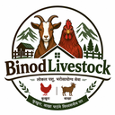
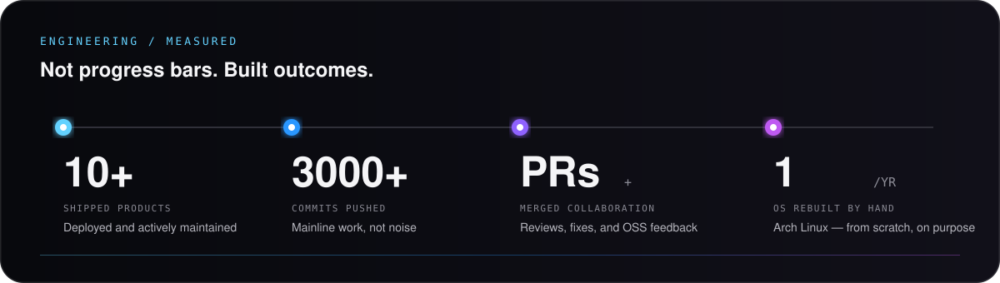

<div align="center">



<br/>

[](https://bikramgole.com.np)
[](https://github.com/BikramGole)
[](mailto:bikramgole.genius@gmail.com)
<a href="https://lounge.ai/@bikramgole"></a>

</div>

<br/>

## Minimal is a design philosophy, not a limitation.

I build small, fast, and understandable systems — from a Linux system compiled from source to AI-assisted local commerce. Every project is a chance to remove, not add.

<br/>



<br/>



<br/>

## Selected work



<table>
<tr>
<td width="50%" valign="top">

###  [KinaHub](https://github.com/BikramGole/KinaHub)

AI-powered local e-commerce and CRM platform connecting sellers and customers with smart recommendations, location-aware delivery optimization, and an LLM shopping assistant via OpenRouter.

`React 19` `TypeScript` `Django REST` `PostgreSQL` `OpenRouter`

</td>
<td width="50%" valign="top">

###  [Android 17](https://github.com/BikramGole/andriod17)

Cinematic interactive showcase for Android 17 "Cinnamon Bun" (API 37) — a marketing site with particle effects, a full-featured Android simulator, and a 3D Android bot built with Three.js.

`React 19` `TypeScript` `Three.js` `Redux Toolkit` `Framer Motion`

</td>
</tr>
<tr>
<td width="50%" valign="top">

###  [BikramGole](https://github.com/BikramGole/Bikram)

My personal website — a space-themed digital realm with a dynamic theme engine, an interactive mini terminal, and a persona quiz. A true reflection of my hacker spirit.

`Vanilla JS` `CSS` `HTML` `Sitemap` `CI`

</td>
<td width="50%" valign="top">

###  [SuperCode](https://supercodedev.vercel.app/)

A real-time collaborative online IDE with shared coding rooms, Monaco editing, multi-file projects, live HTML preview, and Piston-backed code execution.

`React` `TypeScript` `Monaco` `Yjs` `Express` `Supabase`

</td>
</tr>
<tr>
<td width="50%" valign="top">

###  [Binod Livestock](https://www.binodgurung.com.np/)

Bilingual farm-direct livestock storefront for Kathmandu with transparent pricing, product detail views, WhatsApp ordering, and wholesale inquiries.

`Next.js` `React` `Vercel` `WhatsApp`

</td>
<td width="50%" valign="top">

###  [Abyssal Oath](https://abyssal-oath.vercel.app/)

A dark fiction identity site and public archive for the Abyssal-oath collective, built with WebGL, procedural audio, live GitHub data, and a member sanctum.

`Vanilla JS` `Three.js` `Web Audio` `Neon` `Vercel`

</td>
</tr>
<tr>
<td width="50%" valign="top">

###  [Jillab](https://www.jillab.com.np/)

Immersive link-in-bio portfolio with a fullscreen video stage, custom playlist player, canvas snow, glowing cursor, and a Postgres-backed view counter. Also at [jillab.vercel.app](https://jillab.vercel.app/).

`HTML` `CSS` `Vanilla JS` `PostgreSQL` `Sentry`

</td>
<td width="50%" valign="top">

###  [iPhone: The Engineering Marvel](https://work-ios.vercel.app/)

An interactive engineering deep dive through iPhone hardware, using 3D visuals, motion-led storytelling, and detailed component breakdowns. [Source](https://github.com/BikramGole/work-ios).

`React 19` `Three.js` `React Three Fiber` `TypeScript` `Vite`

</td>
</tr>
<tr>
<td width="50%" valign="top">

###  [CommitRank](https://repopulse-hq.vercel.app/)

Real-time GitHub leaderboard and analytics dashboard ranking classmates by contributions, velocity, stars, and repository impact. [Source](https://github.com/BikramGole/RepoPulse).

`Next.js 16` `TypeScript` `Tailwind` `GitHub GraphQL` `D3`

</td>
<td width="50%" valign="top">

###  [Ytdaily](https://github.com/BikramGole/Ytdaily)

High-performance media automation engine with a Rich TUI, PySide6 desktop app, SponsorBlock scrubbing, parallel downloads, and systemd scheduling.

`Python` `PySide6` `Rich` `yt-dlp` `SponsorBlock`

</td>
</tr>
</table>

<br/>

## Engineering, measured



> Every number is tied to shipped work — a deployed product, a merged PR, or a system built from source.

<br/>

## Toolkit

<div align="center">


</div>

<br/>

<div align="center">

[](https://github.com/BikramGole)
[](https://github.com/BikramGole?tab=followers)
[](https://github.com/BikramGole?tab=repositories)
[](https://github.com/BikramGole?tab=following)
[](https://github.com/BikramGole)
[](https://github.com/BikramGole)

</div>

<br/>

---

### 📊 GitHub Stats

<p align="left">

</p>

<div align="center">
  
  
  
  
</div>

<p align="center">
<a href="https://gitranks.com/profile/BikramGole"></a>
</p>

<div align="center">
  
</div>

<br>

<p align="center">
<a href="https://user-badge.committers.top/nepal/BikramGole"></a>
</p>


<p align="center">
<a href="https://wakatime.com/@07f2f83c-a4f8-407e-ac67-6aafb674ebf8"></a>
</p>

---

### 👷 Check out what I'm currently working on

- [SuenoOcho/Insight8x8](https://github.com/SuenoOcho/Insight8x8) - Insight8x8 turns your Chess.com games into useful chess lessons. Enter your username to analyze public games with Stockfish and AI. Understand mistakes, discover missed tactics, explore better moves, and receive personalized feedback in plain language. Learn not just what went wrong, but why—and how to improve your game, one move at a time, always.
- [BikramGole/RepoPulse](https://github.com/BikramGole/RepoPulse) - GitHub leaderboard and developer analytics dashboard for classmates and peer networks, powered by real-time GitHub GraphQL data.
- [BikramGole/Bikram](https://github.com/BikramGole/Bikram) - Dive into my personal website, &#34;The Aura,&#34; a unique blend of AI insights, Linux adventures, and coding explorations. Expect interactive features, dynamic themes, and a dash of controlled chaos in this space-themed digital realm. A true reflection of my hacker spirit! 🚀🎨👾
- [BikramGole/Ytdaily](https://github.com/BikramGole/Ytdaily) - High-performance, automated YouTube feed downloader with TUI, SponsorBlock, and parallel download support.
- [BikramGole/KinaHub](https://github.com/BikramGole/KinaHub) - AI-powered local e-commerce &amp; CRM platform connecting sellers and customers with smart recommendations and delivery optimization.

### 🌱 My latest projects

- [BikramGole/sagarshahi865.github.io](https://github.com/BikramGole/sagarshahi865.github.io) - 
- [BikramGole/RepoPulse](https://github.com/BikramGole/RepoPulse) - GitHub leaderboard and developer analytics dashboard for classmates and peer networks, powered by real-time GitHub GraphQL data.
- [BikramGole/snapcode](https://github.com/BikramGole/snapcode) - Repository snapcode from GitLab
- [BikramGole/annote](https://github.com/BikramGole/annote) - Repository from GitLab: DevXtechnic/annote
- [BikramGole/work-ios](https://github.com/BikramGole/work-ios) - 

### 🔨 My recent Pull Requests

- [Add localhost web version of Insight8x8](https://github.com/SuenoOcho/Insight8x8/pull/1) on [SuenoOcho/Insight8x8](https://github.com/SuenoOcho/Insight8x8)
- [Fix simulator icon ratios and status bar visibility](https://github.com/BikramGole/android17/pull/1) on [BikramGole/android17](https://github.com/BikramGole/android17)
- [docs: update README with hosted site status warning](https://github.com/Rockyffgod/OJT/pull/1) on [Rockyffgod/OJT](https://github.com/Rockyffgod/OJT)
- [Swap demo/walkthrough sections in README](https://github.com/BikramGole/KinaHub/pull/72) on [BikramGole/KinaHub](https://github.com/BikramGole/KinaHub)
- [fix: use dynamic PROJECT_SLUG in sentry-event-checker](https://github.com/BikramGole/KinaHub/pull/71) on [BikramGole/KinaHub](https://github.com/BikramGole/KinaHub)

### ⭐ Recent Stars

- [BikramGole/Abyssocial](https://github.com/BikramGole/Abyssocial) - 
- [BikramGole/Syncara](https://github.com/BikramGole/Syncara) - Carry your playlists everywhere, even when offline
- [BikramGole/sagarshahi865.github.io](https://github.com/BikramGole/sagarshahi865.github.io) - 
- [BikramGole/zenX](https://github.com/BikramGole/zenX) - A multiplayer gaming platform for private friend matches across skill-based and casual games.
- [BikramGole/rice](https://github.com/BikramGole/rice) - 

---

### 💻 About Me

```fish
neo@Arch:~$ cat about_me.txt
```
I enjoy building **minimal systems** that are simple, efficient, and understandable.

Most of my work revolves around:
* **Linux customization** (making it simple & fast)
* **Small CLI utilities** (automating the mundane)
* **AI experiments** (building efficient workflows)
* **Development** (C++, Python, Fish)

---

### 🖥️ System Info

```fish
neo@Arch:~$ fastfetch --structure OS:WM:Shell:Editor:Languages:Focus
```

| Component | Detail |
| :--- | :--- |
| **OS** | Arch Linux |
| **WM** | Hyprland |
| **Shell** | Fish |
| **Editor** | Neovim |
| **Focus** | AI tools, Linux customization, minimal computing |

---

### 🐍 Contribution Snake
<p align="center">


</p>

---

### 📫 Reach Me
- **Email**: [bikramgole.genius@gmail.com](mailto:bikramgole.genius@gmail.com)
- **Email**: [er@bikramgole.com.np](mailto:er@bikramgole.com.np)
- **GitHub**: [BikramGole](https://github.com/BikramGole)

---

<p align="center">
  
</p>
